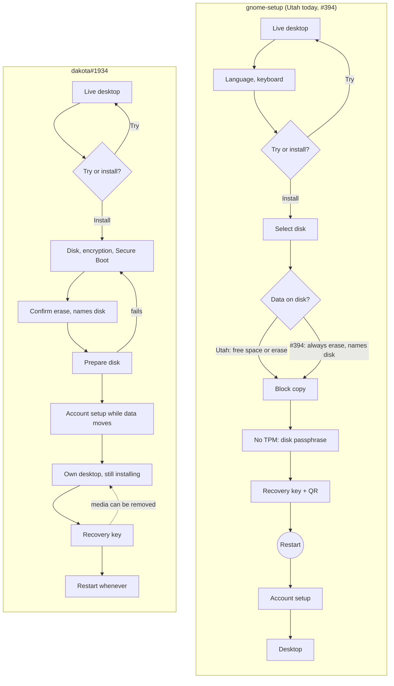
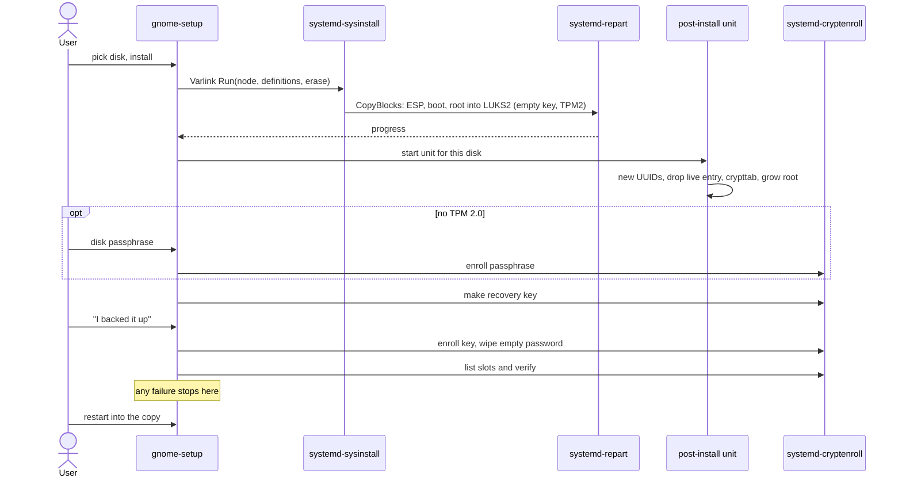
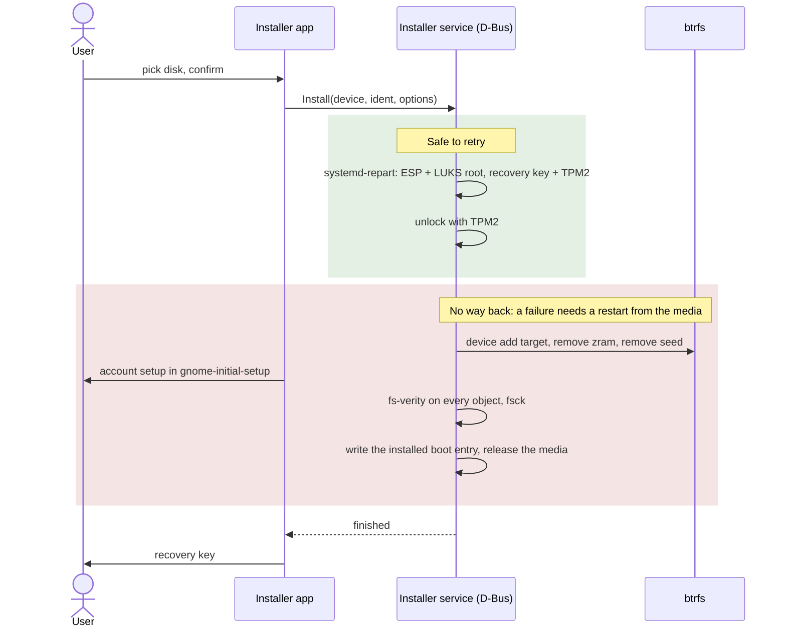
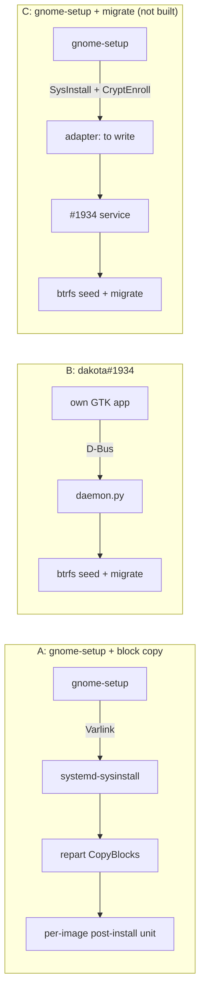
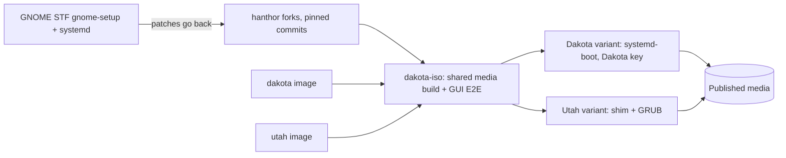
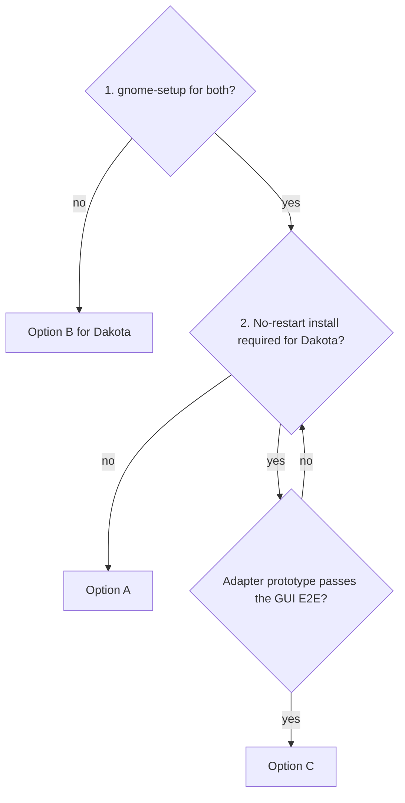

# ADR-0001: One installer for the Dakota and Utah live media

- **Status:** Proposed. Nothing here is decided until castrojo and ahmedadan agree.
- **Date:** 2026-11-25
- **Deciders:** castrojo, ahmedadan (Dakota); hanthor (Utah)

## Context

This repository publishes both live ISOs, with bootc-installer and fisherman.
Three pieces of work would replace that:

| Work | User interface | Install mechanism | Where |
|---|---|---|---|
| [dakota#1934](https://github.com/projectbluefin/dakota/pull/1934) (ahmedadan) | Own GTK application | btrfs seed + migrate: the live session becomes the installed system, no restart. D-Bus service (`GetDisks`, `Install`, ...) | dakota |
| [#394](https://github.com/projectbluefin/dakota-iso/pull/394) (castrojo, draft) | GNOME STF [gnome-setup](https://gitlab.gnome.org/Teams/STF/setup) | Block copy with systemd-sysinstall, ext4 composefs root, restart | dakota-iso |
| [Utah ADR-0001](https://github.com/projectbluefin/utah/blob/main/docs/adr/0001-image-based-installer.md) (hanthor) | gnome-setup | Block copy with systemd-sysinstall, btrfs root, restart | utah |

The user interface and the mechanism are separate choices. gnome-setup calls
`io.systemd.SysInstall` and `io.systemd.CryptEnroll` over Varlink; the mechanism
is whatever answers.

## User flows, side by side

### gnome-setup, Utah E2E run [45696491307](https://github.com/hanthor/utah/actions/runs/45696491307)

The run continues through `bootc switch` and rollback:
[full contact sheet](https://raw.githubusercontent.com/hanthor/dakota-iso/2561389c88171bed6e4f9e000c00936339bd675a/utah-e2e-45696491307.png).

### dakota#1934, Secure Boot off (frames of ahmedadan's demo video)

### dakota#1934, Secure Boot on

#394 has no screenshots published; castrojo, please add some.

## What each does to the disk

**Block copy (Utah; #394 is the same shape with ext4 and systemd-boot)**

**Seed and migrate (dakota#1934, `daemon.py`)**

## Architecture options

For C, three things do not line up today:

- gnome-setup treats `Run` as finished before the recovery key page. #1934 shows
  the key after the move, which the user can work through.
- gnome-setup enrolls the key itself over an empty password. #1934 creates the
  key with the LUKS volume and never has an empty slot.
- gnome-setup ends in a restart. #1934 hands over to account setup first.

**Proposed ownership, whichever mechanism wins**

## What each has shown

As reported by each author; only the Utah rows come from runs linked here.

| | dakota#1934 | #394 | Utah |
|---|---|---|---|
| Install then boot, in a VM | yes: USB and optical | yes: blank and occupied disks | yes, nightly since 2026-11-22 ([45570236605](https://github.com/projectbluefin/utah/actions/runs/45570236605)) |
| TPM2 unlock | yes | yes | yes |
| Recovery key | handed out after the install | enrolled, key slots checked | enrolled, key slots checked by the E2E |
| Secure Boot | on and off, in a VM | enrollment not verified | inherits the image's chain |
| No TPM | encryption off | not stated | disk passphrase |
| Bootable optical ISO | yes | no, raw disk | no, raw disk ([utah#1404](https://github.com/projectbluefin/utah/issues/1404)) |
| Update and rollback after install | `bootc upgrade --check` | yes | yes |
| Automated E2E through the GUI | live boot only | no | yes, seven stages |
| Physical hardware | no | no | no |

## Options

- **A. gnome-setup with block copy.** Closest to #394 and Utah, so most code is
  shared. Needs a restart and a hybrid ISO. Both images must accept a block
  copy; Dakota's first spike ([dakota#1920](https://github.com/projectbluefin/dakota/pull/1920))
  called it a no-go, and #394 has since installed that way.
- **B. The #1934 application with seed and migrate.** Already a bootable ISO
  with no restart. Utah keeps a different installer, and the GUI is ours to
  maintain and translate.
- **C. gnome-setup with seed and migrate.** The #1934 service answers the calls
  gnome-setup makes. Keeps the no-restart install and one GNOME interface for
  both. We know of no build of it: gnome-setup expects an install that finishes before
  its recovery key page, and #1934 moves data while the session runs on.

hanthor's position, as Utah's owner: both images should move to gnome-setup, and
this repository should hold the media code for both. That allows A or C.

## Proposal

1. gnome-setup is the interface for both, from one pinned branch
   ([hanthor/gnome-setup `bluefin`](https://github.com/hanthor/gnome-setup/tree/bluefin)),
   with patches going upstream. It already takes #394's stop-on-failure recovery
   key handling and lets `pages.conf` name the Varlink sockets.
2. This repository builds the media for both, as variants.
3. The mechanism stays open between A and C until the questions below are
   answered. #1934's seed, ISO layout and installer safety rules are the
   reference for C.
4. fisherman stays the production installer until the chosen design passes a GUI
   E2E on both images. No cutover is part of this ADR.

## Questions to decide

1. Interface: gnome-setup for both, or #1934's application for Dakota?
2. Mechanism for Dakota: block copy, or seed and migrate? If C, who prototypes
   the service behind gnome-setup's calls?
3. Does #1934 land in `dakota`, or move here so that one repository builds ISOs?
4. #394's whole-disk erase consent, disk identity checks, and boot entry that
   stays unpublished until recovery works: shared rules for both, or Dakota only?
   Utah's "Existing Data Found" page above offers free space on a blank test
   disk, and does not name the disk when erasing as #394 and #1934 do.
5. Without a TPM 2.0: disk passphrase (Utah) or no encryption (#1934)?
6. Does the gate for a cutover include physical Secure Boot enrollment (#395)?

## Consequences

Until this is accepted, #394 stays a prototype, #1934 is not wired into releases,
and Utah's track stays experimental and gates nothing.
